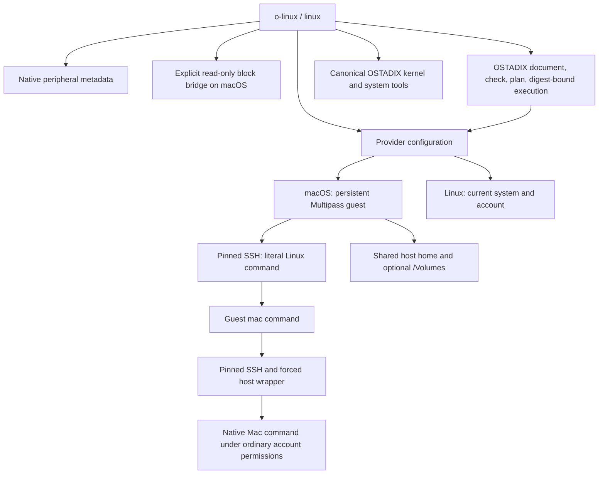

# Architecture

I use two providers behind the same command interface. `multipass` gives a Mac a persistent Linux guest. `native` uses the Linux host itself. Configuration chooses the provider; a command does not silently switch providers or replace a guest.

| Component | Responsibility | Boundary |
| --- | --- | --- |
| `cli.py`, `providers.py` | Command routing, guest startup, working directory, literal arguments | Linux runs in the selected provider; a Mac guest remains a separate kernel |
| `install.py`, `native.py` | Local application, configuration, launchers, installation phases | Existing accounts, providers, launchers, and VM disks are not implicitly replaced |
| `guest_mac.py`, `host_bridge.py` | Guest-to-Mac command transport | Normal host-account privileges and macOS permissions still apply |
| `peripherals.py` | Native host inventory | Metadata reporting is separate from device operation |
| `drives.py`, `drive_frontend.py`, `integrations/ostadix/read-drive.O` | A typed O request and native adapter for remembered-partition read-only opening | The adapter validates the request and saved-profile digest before privileged dispatch |
| `storage.py` | Selected raw image or external physical disk export | Read-only through this export; no filesystem mount or recovery is implied |
| `ostadix.py` | Checked and planned `.O` jobs, result records, kernel/system routes | Uses installed OSTADIX tools and their supported mechanisms |
| `systems.py` | Explicit Linux execution of the installed foreign-system harness | Host O orchestration remains in place; the harness and QEMU execute in the Linux provider |

On macOS, the first ordinary Linux command starts a stopped or suspended configured guest. It does not recreate a missing guest or reset a guest in another state. SSH uses a dedicated identity, a fixed host-key alias, and a private known-host file. The current directory crosses into Linux only when it is within an enabled shared path; other paths fall back to the guest home.

The return path is `/usr/local/bin/mac` inside the guest. It serializes a versioned argument list and working directory, then sends that request through SSH. Its host key is pinned from the public key read locally during setup. The corresponding authorized key on the Mac selects a forced wrapper, restricts the source subnet, and disables forwarding. The wrapper validates the request and uses `exec` with the original argument list. It supplies the configured host home and native tool paths. Binary input/output flows through the ordinary non-PTY path; `--tty` explicitly requests terminal behavior.

The home and volume shares are normal writable working shares. The block-storage path has a separate contract: a pinned read-only file descriptor feeds `qemu-nbd`, an SSH reverse tunnel exposes that export only on guest loopback, and the guest attaches an available NBD device. Guest administration is performed through Multipass. Physical-device selection validates the exact whole external disk, expected size, partition state, and identity; the running bridge checks identity again. The receipt identifies the mapping for cleanup. Independent host writes remain outside the export's guarantee.

The remembered-drive interface is a separate filesystem path through anylinuxfs. Selection saves the partition UUID locally; open resolves that UUID against current metadata rather than retaining a disk number. The installed `read-drive.O` calls `open_request()` to return a typed, fixed read-only request containing the selected profile's digest. It does not mount a drive. The native `drive_frontend.py` evaluates that document, validates its returned request against the current saved profile, then dispatches the privileged host operation outside the backend sandbox. The O backend's ordinary process authority cannot enable sudo under the macOS sandbox, so this boundary is explicit rather than presented as direct privileged O execution.

Ext4 opening requires Linux `ro,noload`, a read-only block device, and a read-only NFS presentation. An existing mount is reused only after verifying those layers and comparing its filesystem UUID with the current physical source signature. This request-and-adapter path does not create the job workflow's source/intent plan or receipt. The environment selects the installation and its private saved configuration; the returned profile digest is checked at dispatch, while hashing the document alone would not freeze the drive selection.

The drive adapter writes a distinct operation receipt containing the request, declaration digest, and native result or uncertainty. Its per-invocation nonce, exact request shape, and fresh profile check must all match before the fixed native `open` call. A single saved-profile lock spans that sequence. Once native dispatch begins, a later execution or receipt-write failure is treated as unknown completion, and the last durable native-operation record remains available if error recording also fails.

The native Linux provider bypasses the VM and SSH command route. Host and Linux targets both execute locally under the current account. The installer adds no packages or drivers. Inventory commands can therefore report missing utilities; that is an observed limitation of that host rather than a reason to create a nested VM. The macOS NBD-to-Multipass bridge is not used by this provider.

An OSTADIX job creates a unique local run directory containing `source.O`, a receipt, check output, the planner's execution intent, evaluator output, and a command result. The `.O` document contains a Python backend call into the installed dispatch module. Before dispatch, the planner's source digest must match the saved document, and the evaluator receives both required digests. The source and intent are bound; mutable runtime dependencies and host state are not frozen by that check. The payload dispatches through the same native or SSH provider used by direct commands.

Recorded job output is text. Direct command transport preserves binary streams. A client timeout is recorded as unknown completion because a remote process can outlive its SSH client. The receipt retains that distinction instead of converting a timeout into evidence that execution stopped.

Kernel and foreign-system routes resolve the native OSTADIX command and invoke its canonical tool entries. Their implementation stays in OSTADIX. o-linux supplies the route, runtime environment, and a default local kernel-build directory; it neither substitutes a kernel implementation nor changes the installed Ubuntu kernel. O-core compilation of external runtimes and complete dependency closure remain separate compiler objectives.

The explicit `systems --linux` route resolves the installed OSTADIX checkout and selects its `scripts/foreign_kernel_lab.py`. That literal Python command enters the checked and planned O job path before dispatch to Linux. By default, a Multipass provider requires the checkout to be shared at its host path. An absolute `--linux-root` or saved `linux_ostadix_root` instead selects a checkout on the Linux filesystem, avoiding shared-filesystem Git latency. This placement option does not replace the host root used for O admission, and the Mac does not try to resolve or prove the existence of a guest-native path. The dispatched harness still performs its own provenance checks.

The default system output directory must be shared when the provider is Multipass. The default guest-artifact cache uses the shared host home so the harness can verify existing downloads. Explicit cache and output overrides remain the caller's Linux paths. A full checkout or a clearly recorded source snapshot preserves the distinction between an upstream revision, local overlays, and the resulting runnable tree. Moving the source into Linux changes placement without patching the harness or bypassing O source and execution-intent admission.

Installation source is copied into the selected state directory so command launchers remain independent of the checkout's later location. Keys and machine-specific configuration are generated locally. Unrelated authorized-key entries are preserved. Existing command launchers require explicit replacement and are backed up. Before changing an existing Mac installation, setup rejects conflicting share mappings. Each installation phase is recorded; failure retains a partial installation with a deterministic retry command. There is no automatic cross-host-and-guest rollback.

The public repository contains reusable source, tests, and documentation. Local credentials, raw storage images, hardware inventories, addresses, and run evidence are excluded. The [verification record](verification.md) states the exercised behavior without treating source inspection or unit tests as live-device proof.
