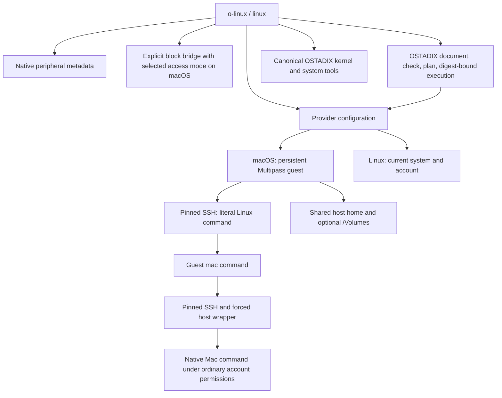

# Architecture

I use two providers behind the same command interface. `multipass` gives a Mac a persistent Linux guest. `native` uses the Linux host itself. Configuration chooses the provider; a command does not silently switch providers or replace a guest.

| Component | Responsibility | Boundary |
| --- | --- | --- |
| `cli.py`, `providers.py` | Command routing, guest startup, working directory, literal arguments | Linux runs in the selected provider; a Mac guest remains a separate kernel |
| `install.py`, `native.py` | Local application, configuration, launchers, installation phases | Existing accounts, providers, launchers, and VM disks are not implicitly replaced |
| `guest_mac.py`, `host_bridge.py` | Guest-to-Mac command transport | Normal host-account privileges and macOS permissions still apply |
| `peripherals.py` | Native host inventory | Metadata reporting is separate from device operation |
| `drives.py`, `drive_frontend.py`, `integrations/ostadix/read-drive.O` | A typed O request and native adapter for opening a remembered partition in its saved mode | The adapter validates the mode-bound request and saved-profile digest before privileged dispatch |
| `storage.py` | Selected raw image or external physical disk export | Descriptor, server and guest device must agree on the requested mode; no filesystem mount or recovery is implied |
| `ostadix.py` | Checked and planned `.O` jobs, result records, kernel/system routes | Uses installed OSTADIX tools and their supported mechanisms |
| `systems.py` | Explicit Linux execution of the installed foreign-system harness | Host O orchestration remains in place; the harness and QEMU execute in the Linux provider |

On macOS, the first ordinary Linux command starts a stopped or suspended configured guest. It does not recreate a missing guest or reset a guest in another state. SSH uses a dedicated identity, a fixed host-key alias, and a private known-host file. The current directory crosses into Linux only when it is within an enabled shared path; other paths fall back to the guest home.

The return path is `/usr/local/bin/mac` inside the guest. It serializes a versioned argument list and working directory, then sends that request through SSH. Its host key is pinned from the public key read locally during setup. The corresponding authorized key on the Mac selects a forced wrapper, restricts the source subnet, and disables forwarding. The wrapper validates the request and uses `exec` with the original argument list. It supplies the configured host home and native tool paths. Binary input/output flows through the ordinary non-PTY path; `--tty` explicitly requests terminal behavior.

The home and volume shares are writable working shares under the mapped account permissions. Setup's explicit `--map-root` option saves `share_root: true` and adds UID/GID `0:0` within those managed shares. Normal user and custom mappings are retained. This addresses Multipass's requirement that a file's owner and group be mapped even when its mode allows ordinary reading. It does not share the Mac's root directory or remove filesystem permissions. Existing shares are upgraded by normal unmount and remount after source and mapping checks; a durable mapping plan retains custom entries if remounting fails. Multipass's stored `default` IDs are resolved to the guest account's numeric IDs before the mount command.

The block-storage path has a separate access mode. `--read-only` or `--read-write` overrides the installation's `storage_access_mode`; an installation without that setting defaults to `ro`. A pinned `O_RDONLY` or `O_RDWR` source descriptor feeds `qemu-nbd`, an SSH reverse tunnel exposes that export only on guest loopback, and the guest attaches an available NBD device. The server flags, client flags and verified guest block-device mode must agree. Host and guest receipts bind the operation, unique export and access mode. Read-write exports permit writes to the selected source; a read-only export blocks writes only through that export.

Physical-device selection validates the exact whole external disk, expected size, partition state and identity. It also checks anylinuxfs instances and their NFS mounts, since diskutil alone may report no partition mount while a microVM holds the raw source. Within one installation, a physical export holds the saved-drive lock from preflight through cleanup; the anylinuxfs open path uses that same lock. A retained physical-export state continues to block filesystem opening after the initiating process exits. These checks coordinate the managed paths; independent host writers and separate installations remain outside the lock's scope.

Read-write NBD cleanup checks the guest helper's mount namespace for mounted device or partition filesystems, rejects block holders, flushes buffers, and rechecks the owning client before disconnecting. An unresolved cleanup retains the server, tunnel and operation receipt so an active guest filesystem does not lose its backing export merely because the caller exits. Receipt-based cleanup can detach the guest operation without reopening its source. Recorded host PIDs alone do not authorize stopping surviving processes; unresolved host ownership remains recorded for reconciliation.

The remembered-drive interface is a separate filesystem path through anylinuxfs. Selection saves the partition UUID and access mode locally; open resolves that UUID against current metadata rather than retaining a disk number. New selections default to `rw`, while legacy selections without a mode retain `ro`. `drive mode rw|ro` changes the saved mode only when the selection is closed and has no unresolved mount operation.

The installed `read-drive.O` keeps its compatibility filename and calls `open_request()` to return a typed `o-linux.drive-request/v2` request. Its `access_mode`, corresponding `open-readonly` or `open-readwrite` action, installation, saved-profile digest and nonce must all match the native caller's expected request. The document does not mount a drive or select arbitrary commands. The native `drive_frontend.py` evaluates it, checks the current profile again, then invokes the fixed native open operation outside the backend sandbox. The O backend's ordinary process authority cannot enable sudo under the macOS sandbox, so this boundary is explicit rather than presented as direct privileged O execution.

Ext4 verification checks four access layers: guest block device, guest filesystem, NFS export and host NFS mount. Read-only mode requires block `ro=1`, ext4 `ro,noload` or its effective `norecovery` form, and read-only export and host mounting. Read-write mode requires block `ro=0`, ext4 `rw` without journal-replay suppression, and writable export and host mounting. An existing mount is reused only after those checks and comparison of its filesystem UUID with the current physical source signature. Mode changes therefore do not relabel an existing mount. This request-and-adapter path has its own receipt and does not create the job workflow's source/intent plan. The environment selects the installation and its private saved configuration; the returned profile digest is checked at dispatch, while hashing the document alone would not freeze the selection or mode.

The drive adapter writes a distinct operation receipt containing the request, selected-mode authority, declaration digest, and native result or uncertainty. Its per-invocation nonce, exact request shape, and fresh profile check must all match before the fixed native `open` call. A single saved-profile lock spans that sequence. Once native dispatch begins, a later execution or receipt-write failure is treated as unknown completion, and the last durable native-operation record remains available if error recording also fails.

Reconnection also handles retained inactive macOS device nodes. Apple defines an inactive I/O service as terminated and awaiting its remaining clients' closure in [IOService.h](https://github.com/apple-oss-distributions/xnu/blob/main/iokit/IOKit/IOService.h). The adapter binds the old block/raw device numbers to unique inactive IOMedia parent/partition records, their ancestry, saved partition UUID and both sizes, and absence from the active disk inventory. An exact saved mount receipt and fresh physical signature of the current partition are still required before normal unmount. Teardown intent is durable before dispatch, identity is rechecked after persistence, and uncertain completion never causes repeated teardown. This is not an atomic compare-and-unmount API; independent external mount changes remain outside the profile lock.

The native Linux provider runs ordinary commands locally without creating a VM. Host and Linux job targets both execute locally under the current account. The installer adds no packages or drivers. Inventory commands can therefore report missing utilities; that is an observed limitation of that host rather than a reason to create a nested VM. The macOS NBD-to-Multipass bridge is not used by this provider.

Saved-drive commands have an explicit host route in a provisioned Linux guest. `guest_drive.py` validates the Mac bridge configuration and sends literal arguments through `guest_mac.py` to the host's absolute launcher. The internal `_host-drive` entry requires Darwin before loading configuration, so a misconfigured Linux destination cannot forward recursively. The host retains its saved selection, `.O` declaration, native adapter and receipts. Captured commands preserve separate streams without a PTY; interactive commands can authorize sudo in the same host session. This route adds no block device to the guest.

An OSTADIX job creates a unique local run directory containing `source.O`, a receipt, check output, the planner's execution intent, evaluator output, and a command result. The `.O` document contains a Python backend call into the installed dispatch module. Before dispatch, the planner's source digest must match the saved document, and the evaluator receives both required digests. The source and intent are bound; mutable runtime dependencies and host state are not frozen by that check. The payload dispatches through the same native or SSH provider used by direct commands.

Recorded job output is text. Direct command transport preserves binary streams. A client timeout is recorded as unknown completion because a remote process can outlive its SSH client. The receipt retains that distinction instead of converting a timeout into evidence that execution stopped.

Kernel and foreign-system routes resolve the native OSTADIX command and invoke its canonical tool entries. Their implementation stays in OSTADIX. o-linux supplies the route, runtime environment, and a default local kernel-build directory; it neither substitutes a kernel implementation nor changes the installed Ubuntu kernel. O-core compilation of external runtimes and complete dependency closure remain separate compiler objectives.

The explicit `systems --linux` route resolves the installed OSTADIX checkout and selects its `scripts/foreign_kernel_lab.py`. That literal Python command enters the checked and planned O job path before dispatch to Linux. By default, a Multipass provider requires the checkout to be shared at its host path. An absolute `--linux-root` or saved `linux_ostadix_root` instead selects a checkout on the Linux filesystem, avoiding shared-filesystem Git latency. This placement option does not replace the host root used for O admission, and the Mac does not try to resolve or prove the existence of a guest-native path. The dispatched harness still performs its own provenance checks.

The default system output directory must be shared when the provider is Multipass. The default guest-artifact cache uses the shared host home so the harness can verify existing downloads. Explicit cache and output overrides remain the caller's Linux paths. A full checkout or a clearly recorded source snapshot preserves the distinction between an upstream revision, local overlays, and the resulting runnable tree. Moving the source into Linux changes placement without patching the harness or bypassing O source and execution-intent admission.

Installation source is copied into the selected state directory so command launchers remain independent of the checkout's later location. Keys and machine-specific configuration are generated locally. Unrelated authorized-key entries are preserved. Existing command launchers require explicit replacement and are backed up. Before changing an existing Mac installation, setup rejects conflicting share sources and root ID mappings. Each installation phase and share update is recorded; failure retains a partial installation with a deterministic retry command, including `--map-root` when selected. A changed source or ownership mapping detected by the final pre-dispatch check stops that share update. There is no automatic cross-host-and-guest rollback.

The public repository contains reusable source, tests, and documentation. Local credentials, raw storage images, hardware inventories, addresses, and run evidence are excluded. The [verification record](verification.md) states the exercised behavior without treating source inspection or unit tests as live-device proof.
